# 💧 NamKUB Store — เว็บขายน้ำดื่มออนไลน์พร้อมระบบจัดการหลังบ้าน

## 📖 เกี่ยวกับโปรเจกต์

**NamKUB Store** เป็นเว็บแอปสำหรับสั่งซื้อน้ำดื่ม (Singha, Crystal, Nestle, Minere) ฝั่งลูกค้าเลือกสินค้า ใส่ตะกร้า และสั่งซื้อพร้อมที่อยู่จัดส่งได้ ส่วนฝั่งผู้ดูแลมีแดชบอร์ดสรุปยอดขาย จัดการสินค้า สต็อก ซัพพลายเออร์ ออเดอร์ และรายชื่อสมาชิก

โปรเจกต์แบ่งเป็น 2 ส่วนในรีโพเดียว

- **Backend**: REST API ด้วย Node.js + Express ยืนยันตัวตนด้วย JWT (`BackEnd/userAPI`)
- **Frontend**: Angular 18 (SSR) เรียก API ผ่าน HTTP/JSON (`FontEnd/NamKUB-Store`)

เริ่มจากงานของรายวิชาการเขียนโปรแกรมทางธุรกิจ และพัฒนาต่อเป็นผลงานในพอร์ตโฟลิโอ ล่าสุดปรับหน้าตา UI ใหม่ทั้งฝั่งลูกค้าและผู้ดูแล

| รหัสวิชา | ชื่อวิชา | หน่วยกิต |
|---|---|---|
| 02739341 | การเขียนโปรแกรมทางธุรกิจ (Business Programming) | 3 |

> โปรเจกต์นี้ยังไม่มีระบบชำระเงินจริง

## 📸 ภาพหน้าจอ

ภาพด้านล่างใช้ข้อมูลตัวอย่าง หน้าฝั่งลูกค้าแสดงในโหมดมืด (สลับได้ที่ไอคอนดวงจันทร์บน header) ส่วนหน้าเข้าสู่ระบบ แก้ไขโปรไฟล์ และหน้าผู้ดูแลยังมีเฉพาะธีมสว่าง

**หน้าสาธารณะ**

| เข้าสู่ระบบ | สมัครสมาชิก |
|---|---|
| 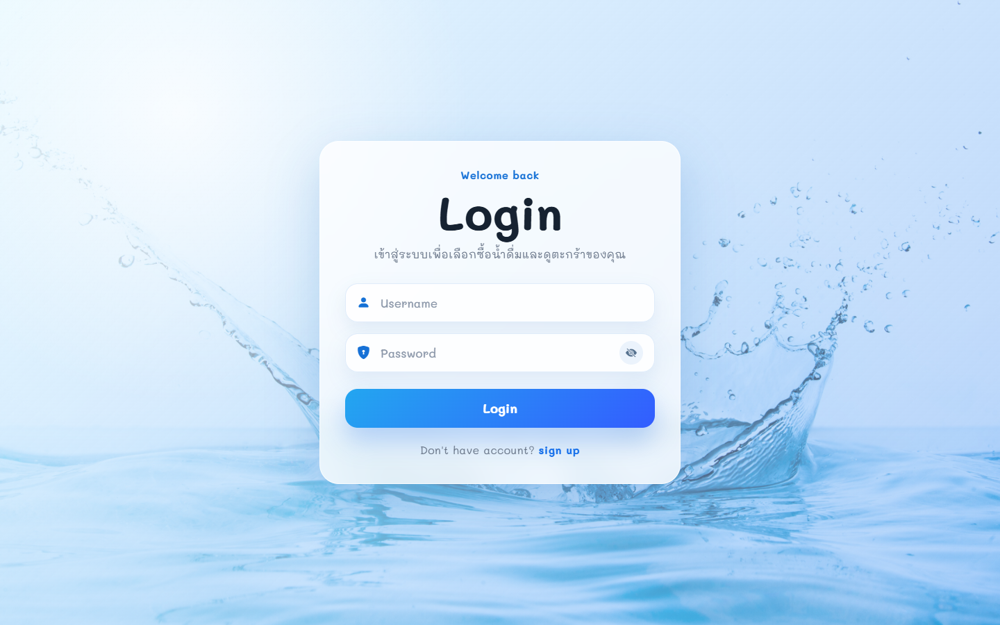 | 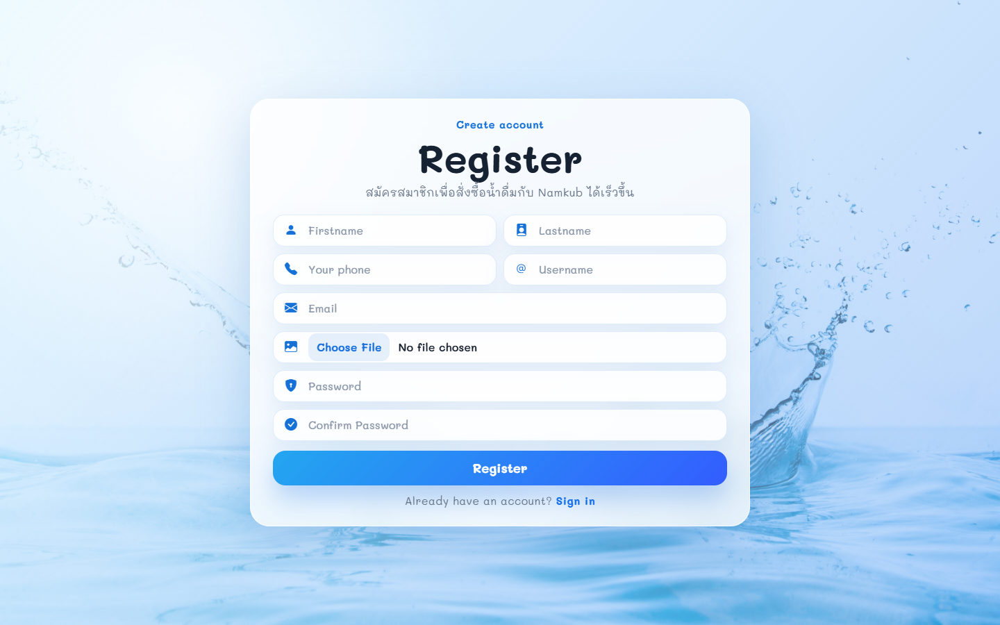 |

**ฝั่งลูกค้า**

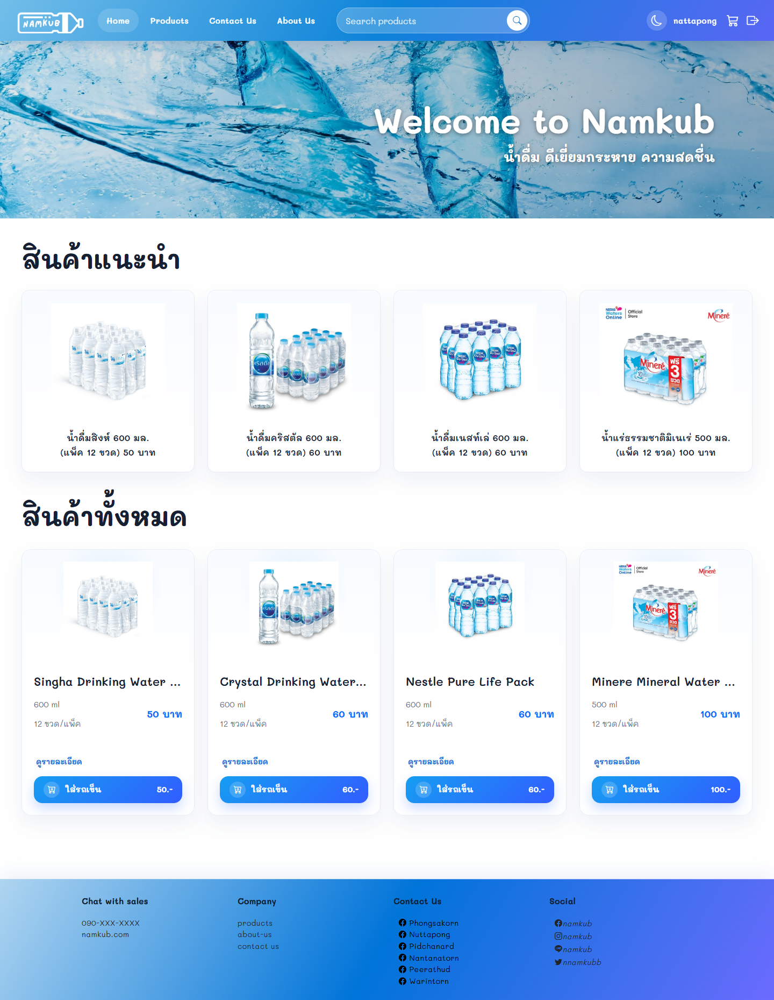

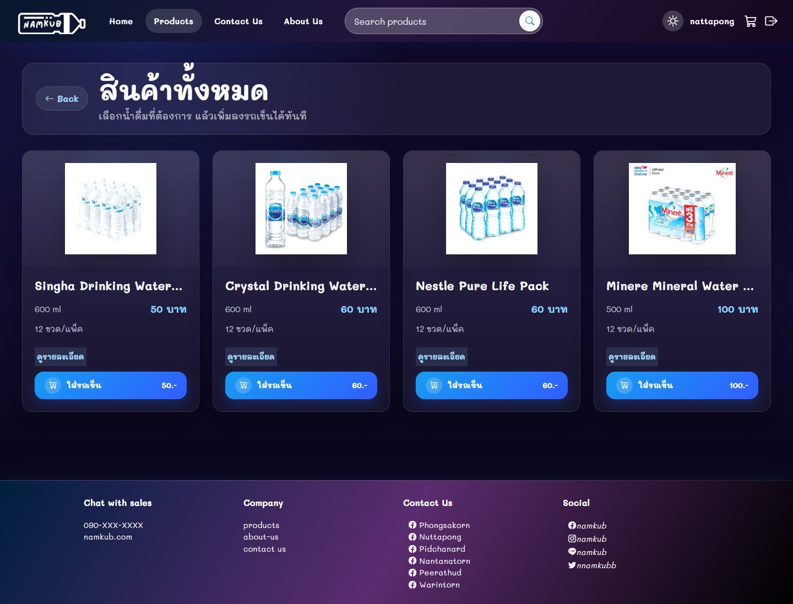

| ตะกร้าสินค้า | แก้ไขโปรไฟล์ |
|---|---|
| 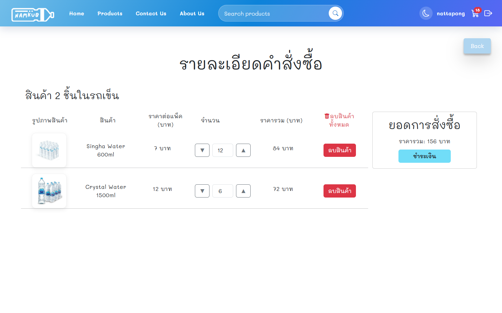 | 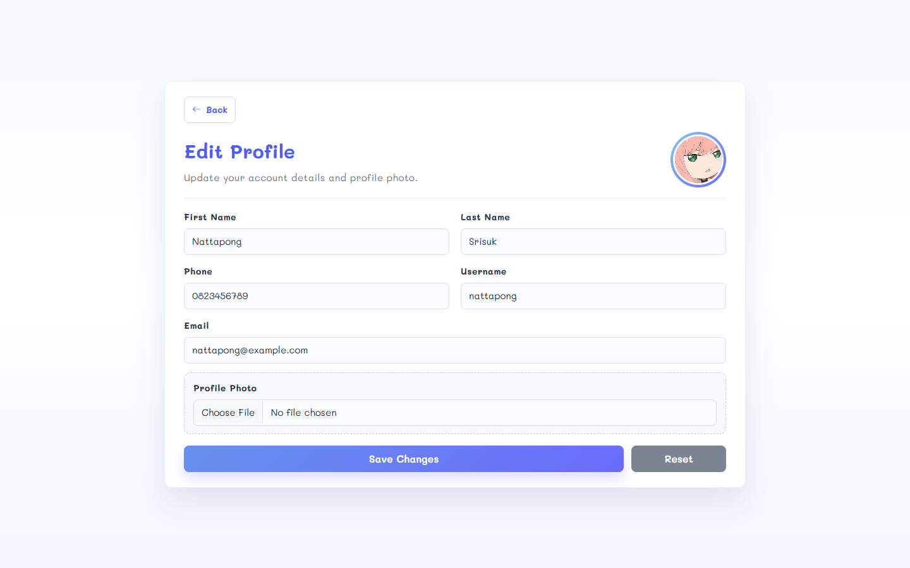 |

| เกี่ยวกับเรา | ติดต่อเรา |
|---|---|
| 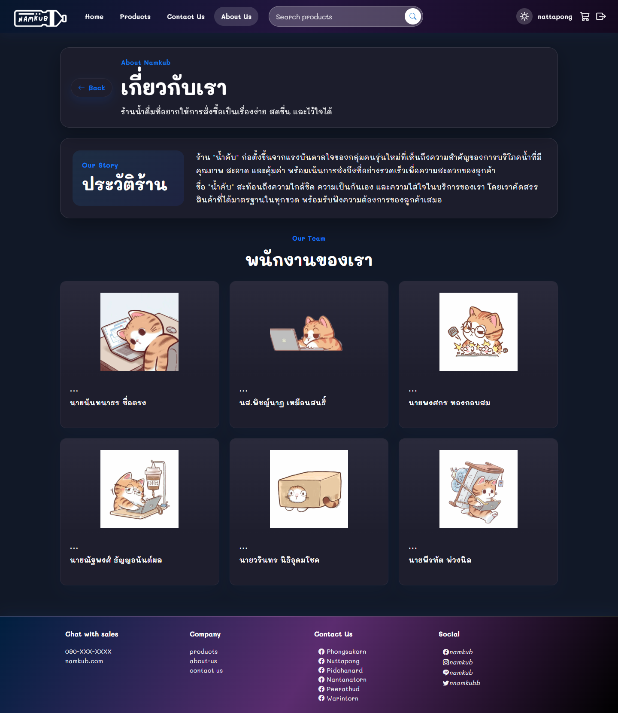 | 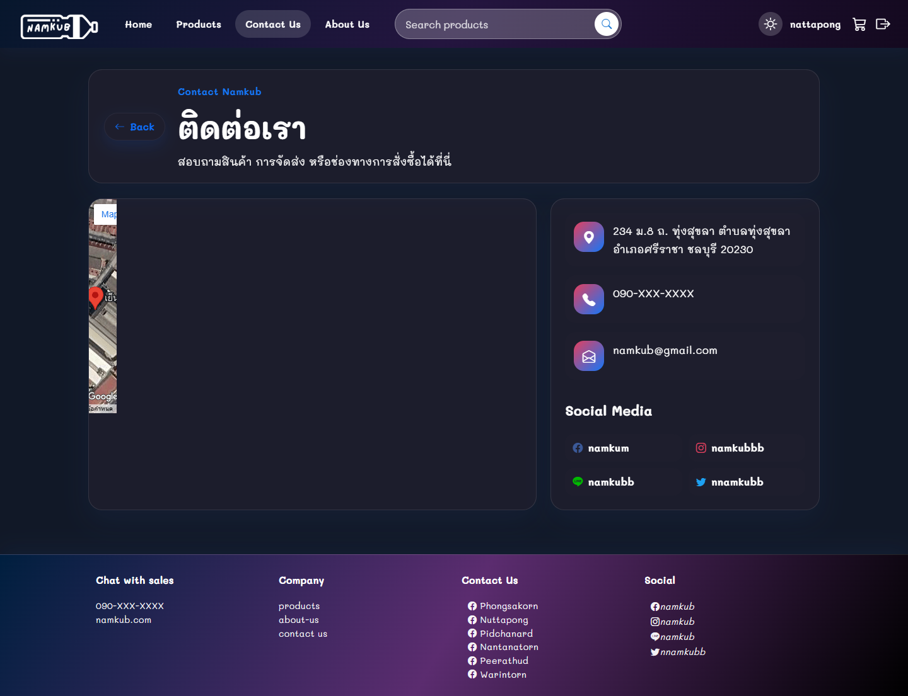 |

**ฝั่งผู้ดูแล (admin)**

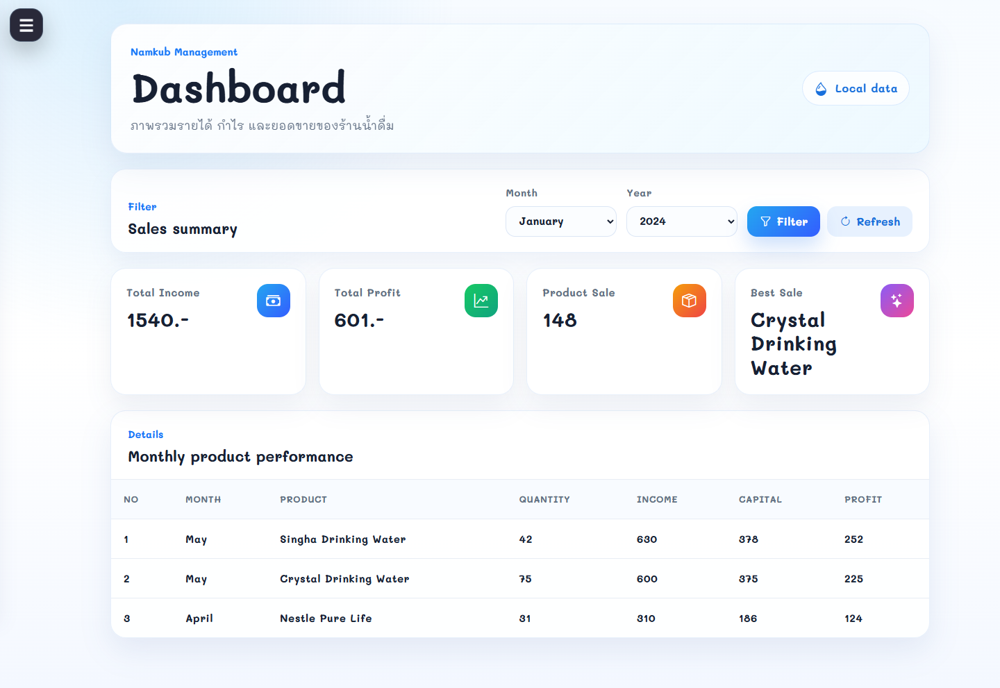

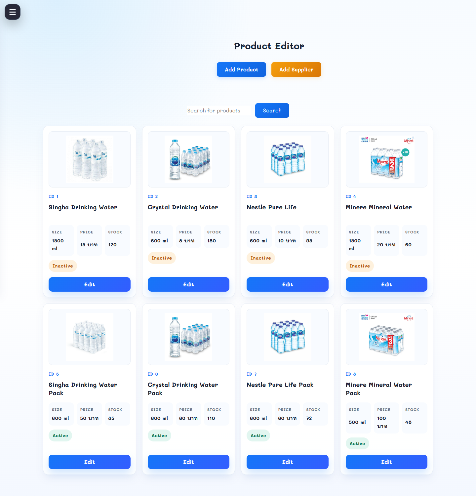

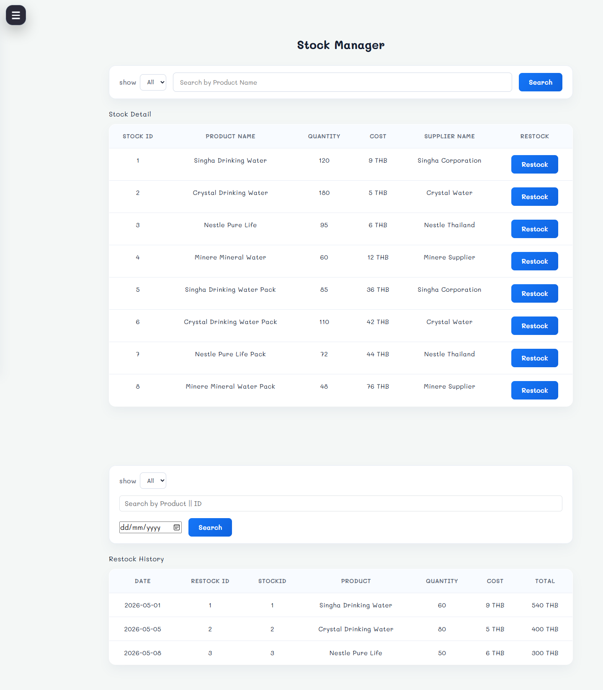

| รายการออเดอร์ | รายชื่อสมาชิก |
|---|---|
| 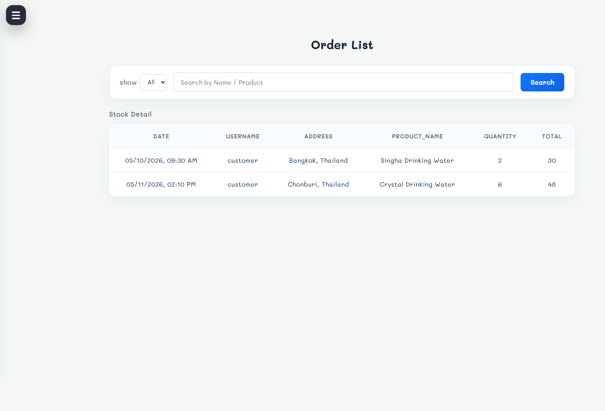 | 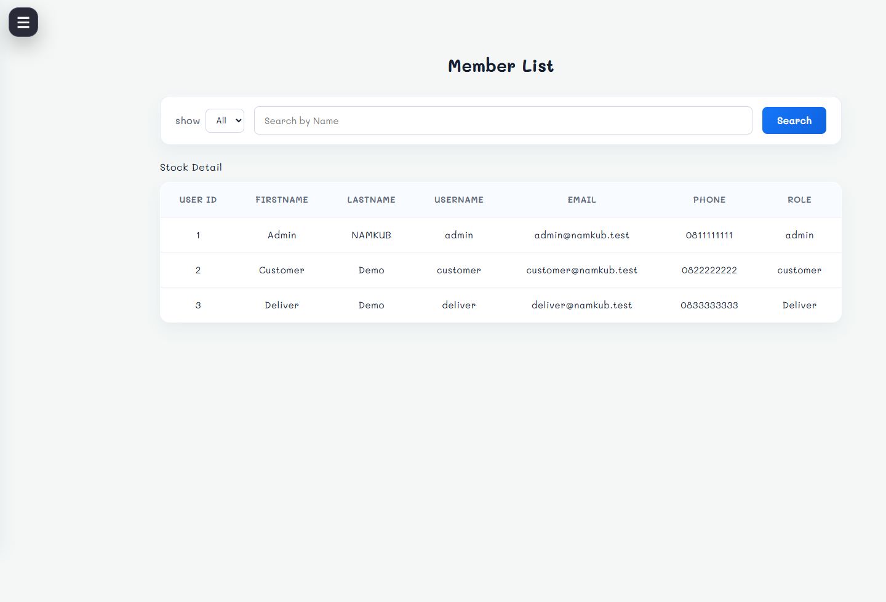 |

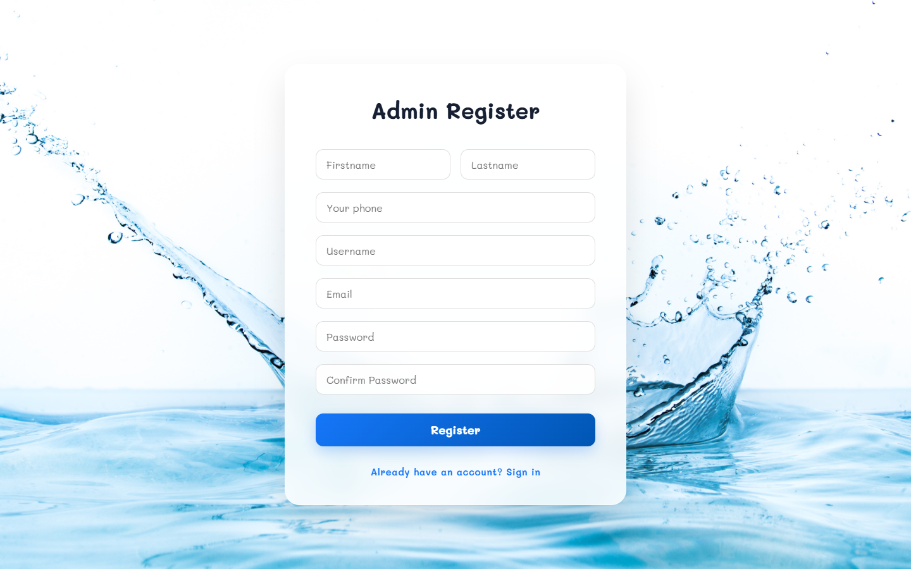

## 🛠️ เทคโนโลยี

| ส่วน | ที่ใช้ |
|---|---|
| Frontend | Angular 18 (SSR), Angular Material, Bootstrap 5, DataTables, SweetAlert2 |
| Backend | Node.js, Express 4 |
| ฐานข้อมูล | Microsoft SQL Server (`mssql` / `tedious`) |
| Auth | JWT (`jsonwebtoken`), bcrypt, `jwt-decode` ฝั่งหน้าเว็บ |
| อื่น ๆ | dotenv, cors, morgan, moment-timezone |

## ✨ ฟีเจอร์

**🛒 ลูกค้า (customer)**
- สมัครสมาชิก / เข้าสู่ระบบ (รหัสผ่านเข้ารหัสด้วย bcrypt, session ด้วย JWT)
- ดูรายการสินค้า ค้นหาสินค้า และดูหน้ารายละเอียดสินค้าแต่ละรุ่น
- ตะกร้าสินค้า และชำระเงิน / สั่งซื้อ พร้อมบันทึกที่อยู่จัดส่งล่าสุดของลูกค้า
- แก้ไขโปรไฟล์และรูปโปรไฟล์

**📊 ผู้ดูแล (admin)**
- แดชบอร์ด: ยอดขายรายเดือน ยอดขายรวมตลอดเวลา และสินค้าขายดี
- จัดการสินค้า: เพิ่ม แก้ไข ลบ ตรวจสอบชื่อสินค้าซ้ำ
- จัดการสต็อก: ดูสต็อกคงเหลือ เติมสต็อก (restock) ดูประวัติการเติม และค้นหา
- จัดการออเดอร์: ดูรายการ ค้นหาตามชื่อลูกค้า / สินค้า
- รายชื่อสมาชิก และค้นหาสมาชิก
- เพิ่มและดูรายชื่อซัพพลายเออร์
- สมัครบัญชีผู้ดูแลเพิ่ม

**🔐 ระบบหลังบ้านและความปลอดภัย**
- แยกสิทธิ์ 3 บทบาท: `admin`, `customer`, `Deliver` ทั้งที่ route guard ฝั่งหน้าเว็บ และ middleware ฝั่ง API
- สมัครบัญชีพนักงานจัดส่ง (`/Deliver_register`)
- สั่งซื้อทำงานเป็น transaction เดียว: สร้างออเดอร์ → รายการสินค้า → ใบส่งของ (`Delivery_Bill`)
- เก็บรหัสผ่านด้วย bcrypt (salt rounds = 10)
- JWT หมดอายุใน 1 ชั่วโมง ส่งผ่านหัว `Authorization: Bearer <token>`
- Route guard ฝั่ง Angular แยกสิทธิ์ตามบทบาท และมีหน้า `NoAccess`
- Query ฝั่ง API ใช้ parameterized input (`.input(...)`) ของ `mssql`
- ไฟล์ `.env` ถูก ignore จาก git

## 🏗️ สถาปัตยกรรม

```
 Angular 18 (:4200)  --HTTP/JSON-->  Express API (:3000)  --mssql-->  SQL Server
   AuthGuard (role)                   Controller / Routes              ตาราง + View
   namkub-api.service                 Middleware: JWT, checkRole
```

- ตารางที่โค้ดอ้างถึง: `Users`, `tbl_Customer`, `tbl_Order`, `tbl_OrderDetails`, `Delivery_Bill`
- View ที่ใช้อยู่ เช่น `OrderView` (ส่วน stock มี `/stockview` และ `/restockview`)
- ผู้ใช้หนึ่งคนมีแถวใน `Users` และมีโปรไฟล์ตามบทบาท (เช่น `tbl_Customer`)

## 📁 โครงสร้างโปรเจกต์

```
NAMKUB-Store/
├── BackEnd/userAPI/
│   ├── app.js                  # จุดเริ่มต้น Express และเชื่อมต่อฐานข้อมูล
│   ├── config.js               # ตั้งค่าการเชื่อมต่อ SQL Server (อ่านจาก .env)
│   ├── routes/                 # กำหนดเส้นทาง API
│   ├── Controller/             # logic: login, register, products, stock,
│   │                           # order, users, supplier
│   └── Middleware/auth.js      # ตรวจ JWT และบทบาท
├── FontEnd/NamKUB-Store/
│   ├── public/                 # รูปสินค้าและโลโก้
│   └── src/app/
│       ├── UserSite/           # หน้าลูกค้า: home, product, cart, payment,
│       │                       # edit-profile, ...
│       ├── AdminSite/          # หน้าผู้ดูแล: dashboard, order, stock,
│       │                       # editproduct, memberlist, ...
│       ├── Service/            # เรียก API และจัดการตะกร้า
│       └── auth.guard.ts       # ป้องกัน route ตามบทบาท
└── docs/screenshots/           # ภาพหน้าจอที่ใช้ใน README
```

## ✅ สิ่งที่ต้องมีก่อน

- **Node.js** (พร้อม npm)
- **Angular CLI**
- **Microsoft SQL Server** ที่เปิด TCP/IP และสร้างฐานข้อมูลเปล่าไว้ล่วงหน้า

## 🚀 การติดตั้งและรันโปรเจกต์

1. **โคลนโปรเจกต์**

   ```bash
   git clone <repo-url>
   cd NAMKUB-Store
   ```

2. **ตั้งค่าและรัน Backend**

   ```bash
   cd BackEnd/userAPI
   npm install
   ```

   สร้างไฟล์ `BackEnd/userAPI/.env`

   | ตัวแปร | ความหมาย |
   |---|---|
   | `DB_USER` | ชื่อผู้ใช้ SQL Server |
   | `DB_PASSWORD` | รหัสผ่าน SQL Server |
   | `DB_NAME` | ชื่อฐานข้อมูล |
   | `DB_PORT` | พอร์ต SQL Server (ปกติ 1433) |

   เซิร์ฟเวอร์ฐานข้อมูลถูกกำหนดเป็น `localhost` ใน `config.js` จากนั้นรัน

   ```bash
   npm start          # http://localhost:3000
   # หรือ npm run startmon เพื่อใช้ nodemon
   ```

3. **รัน Frontend** (เปิดอีกหนึ่งเทอร์มินัล)

   ```bash
   cd FontEnd/NamKUB-Store
   npm install
   npm start          # http://localhost:4200
   ```

   หน้าเว็บเรียก API ที่ `http://localhost:3000` (กำหนดใน `src/app/Service/namkub-api.service.ts`)

> ในรีโพนี้ยังไม่มีสคริปต์สร้างฐานข้อมูล ต้องสร้างตารางและ view ให้ตรงกับที่โค้ดเรียกใช้เอง

## 🔌 ภาพรวม API

| กลุ่ม | Route | หมายเหตุ |
|---|---|---|
| Auth | `POST /login`, `POST /register`, `POST /Deliver_register` | สาธารณะ |
| สินค้า | `GET /products`, `GET /products/:id`, `GET /activeproduct`, `GET /search`, `POST /products`, `PUT /products/:id`, `DELETE /products/:id` | |
| สต็อก | `GET /stock`, `GET /stockview`, `GET /restockview`, `POST /restock`, `GET /sreachstock`, `GET /sreachrestock` | |
| ออเดอร์ | `POST /order`, `GET /getorder`, `GET /findOrder`, `GET /findMonth` | |
| รายงาน | `GET /summary`, `GET /AlltimeSUM`, `GET /GetBestSale` | ใช้ในแดชบอร์ด |
| สมาชิก | `GET /user`, `GET /sreachuser`, `POST /cusaddress` | |
| ซัพพลายเออร์ | `GET /getSupplier`, `POST /addsupplier` | |
| ทดสอบสิทธิ์ | `GET /test` | ต้องใช้ JWT และบทบาท `admin` |

## ⚠️ ข้อจำกัดที่ทราบ

- JWT secret เขียนตายในโค้ด (`jwtsecret`) ควรย้ายไปไว้ใน `.env` ก่อนนำไปใช้จริง
- ปัจจุบันมีเพียง `/test` ที่ถูกป้องกันด้วย `auth` + `checkRole` ส่วน route อื่นของ API (สินค้า สต็อก ออเดอร์ สมาชิก) ยังเปิดให้เรียกได้โดยไม่ต้องมี token การป้องกันหลักอยู่ที่ฝั่งหน้าเว็บ
- `config.js` ถูกใส่ไว้ใน `.gitignore` ของ backend แต่ไฟล์นี้จำเป็นต่อการรัน ควรตรวจว่าไม่ติดไปกับ repo
- URL ของ API ฝั่งหน้าเว็บเป็น `localhost:3000` แบบตายตัว
- ไม่มีสคริปต์สร้างฐานข้อมูลและยังไม่มีชุดทดสอบ (`npm test` ของ backend เป็นค่าเริ่มต้น)
- ยังไม่มีระบบชำระเงินจริง
